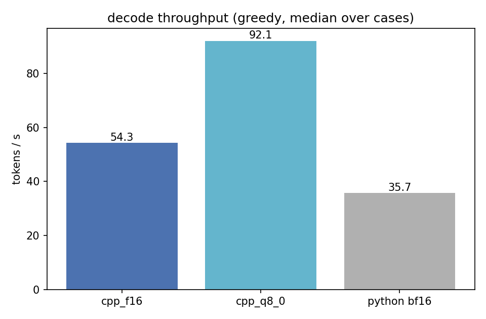

# Model Cards — cpp_ggml assets

Status 2026-10-18 (d11 close-out): the full C++ chain is gated and equivalent
to the official python pipeline — greedy tokens are identical on cpu/cuda/
vulkan for f16/q8_0/f32 weight tiers (d6), and the end-to-end launcher parity
holds without `--bbox-list` (d7). The performance alignment table lives in
`docs/inference.md` ("C++ (GGML) Backend"). This card lists every GGUF the
converters produce, which tier each stage loads by default, and the parity
evidence per component.

## Published weights

All runtime GGUFs are published at
**[Asher-1/VLX-Seek-1.5-10B-GGUF](https://huggingface.co/Asher-1/VLX-Seek-1.5-10B-GGUF)**
(with the model card embedding the accuracy and latency evidence below).

## End-to-end latency, every backend and precision

Full matrix: `benchmarks/results/latency_matrix.json`; methodology in
`benchmarks/README.md`. Every C++ GPU tier decodes faster than the official
python backend; CUDA q8_0 reaches 1.12x of the python TTFT.

## Qualitative parity (official-style visualization, identical prompts)

Left: C++ (GGML). Right: official python. Both rendered by the official
`visualize_result_boxes`. Six more panels live in `../benchmarks/charts/`.

---

## Asset map: one inference = five files

VLX-Seek 1.5 is a region-first pipeline of four networks plus one LLM. The
GGUF directory mirrors that structure; a single `vlx-cli run` loads exactly
five of the files below and frees the vision weights before the LLM loads
(device peak 15.5 GiB f16 / 8.6 GiB q8_0 on cuda):

| File | Component | Default tier | Size | Role in the chain |
|---|---|---|---|---|
| `wedetect-base-uni-f32.gguf` | WeDetect-Base-Uni | **f32 (fixed)** | 431 MB | image → 100 region proposals |
| `vlx-vision-10b-f16.gguf` | **merged vision stack**: mmproj (main tower) + fpn (SimpleFPN) + radio (C-RADIOv4 aux), 708 tensors | f16 | 2.02 GiB | image → image tokens + 4-level region features |
| `vlx-10b-llm-f16.gguf` | Qwen3.5 10B LLM (`qwen35`) | f16 | 17.9 GB | text generation |

Per-tier alternates: `vlx-vision-10b-q8_0.gguf` (1.35 GiB) and
`vlx-10b-llm-q8_0.gguf` (9.5 GB); the detector also ships f16/q8_0 gate
artifacts, and `synth-radio-f32.gguf` is the 1 MB regression fixture. HFRE
(RoIAlign + sine box embedding + fusion) is host-side C++ with no weights
file. A full `vlx-cli run` loads exactly three files (detector, vision, LLM)
and frees the vision weights before the LLM loads (device peak 15.5 GiB f16 /
8.6 GiB q8_0 on cuda).

**Why the vision stack is one file (since 2026-10-18)**: the three converters
already use disjoint tensor namespaces (`mmproj.*`, `radio.*`, fpn incl.
`aux_proj.*`), so `scripts/merge_vision_gguf.py` concatenates them byte-
level into one GGUF per tier (708 tensors, verified byte-identical); the
C++ loader picks it up automatically and falls back to the per-part files
when explicit `--radio/--mmproj/--fpn` overrides are given. Merged runs are
output-identical to the per-part runs, and the single sequential read cut
the cold-start vision setup from ~2.2 s to ~0.77 s. The LLM stays separate:
llama.cpp's `qwen35` arch loader rejects foreign tensors, and the memory
lifecycle requires freeing vision before the LLM loads.

**Why the LLM has no f32 file**: the official checkpoint is bf16; f16 stores
those values bit-exactly, so an f32 file would be identical values at twice
the bytes.

**Why the vision f32 alternates are not shipped**: f16 already passes the full
three-way gate (ratio ≤ 1.0 against the official f32 referee). The f32 tier's
only role is a structural referee run when bisecting a gate failure
("does the graph drift without weight quantization?"); rebuild on demand with
`scripts/convert_vision_to_gguf.py` / `convert_mmproj_to_gguf.py` /
`convert_fpn_to_gguf.py --dtype f32`, then `scripts/merge_vision_gguf.py
--dtype f32` (~4.1 GB).

**Why WeDetect is pinned to f32**: the box set feeds the LLM. q8_0 changes the
box set outright; f16's sub-pixel shifts can reorder near-tied raster sort
keys. The f32 tier matches the official `.pth` dtype (d1: bit-exact CPU
proposals). Its f16/q8_0 files exist only to prove the conv graph on
quantized weights (d3 gate); they are not loaded by `vlx-cli run`.

---

## 1. synth-radio-f32.gguf — topology fixture (not a model)

| Field | Value |
|---|---|
| Source | `scripts/make_synth_radio.py` (deterministic, seed 7) |
| Architecture | C-RADIOv4-SO400M topology, shrunken: dim 64, heads 4, depth 4, mlp 256, pos grid 8×8, cls 1 + register 1 (skip=2), patch 16 |
| Precision / Size | F32 / ~1 MB |
| Purpose | **Regression entry point.** Exercises the full tool chain (convert → torch dump → radio-cli → compare_parity) in seconds without the 10B download. Verifies gather-table order, CPE pos resize/crop, cls/register prefix, pre-norm block structure, tap points — not weight values. |
| Parity | 4/4 levels, 0 violations (band 0.5/0.05) |
| Known blind spots | Symmetric grid (pos 8×8, input == pos size) hides h/w transposes and makes interpolation an identity; non-square inputs must be re-verified against the real model (they were — real-weight gates below). |
| Keep or delete? | Keep: it is the only sub-second structural regression tool and costs 1 MB. |

## 2. wedetect-base-uni-{f32,f16,q8_0}.gguf

| Field | Value |
|---|---|
| Source | `fushh7/WeDetect` (`wedetect_base_uni.pth`) via `scripts/convert_wedetect_to_gguf.py` |
| Architecture | YOLO-World family: ConvNeXt-B backbone (dw convs as CWHN im2col graphs), CSPRepBiFPANNeck, YOLOWorldHeadModule (BN-contrastive open-vocabulary head, 256 prompts); letterbox 640, per-class NMS 0.7, top-100; BN / layer-scale / logit-scale folded at conversion. Host post-process mirrors `head_predict` + `forward` exactly (sigmoid / top-30000 / NMS / letterbox undo / clamp / validity filter). |
| Runtime tier | f32 = the official `.pth` dtype (fixed, see asset map). f16/q8_0: gate artifacts. |
| Sizes | 431 MB (f32) / 218 MB (f16) / 118 MB (q8_0) |
| Purpose | Region proposals (100 boxes) for the decoupled pipeline; replaces the PyTorch-only `detect_tools/WeDetect/generate_proposal.py` in the C++ chain. `vlx-cli run` runs it natively when `--bbox-list` is omitted. |
| Parity status | d1: CPU f32 proposals **bit-exact** vs python (after the dw-CWHN fix). d2: strict-fp32 patch, CUDA and Vulkan detect gates PASS. d3: f16/q8_0 tiers convert and pass the detect gate. d7: end-to-end (native proposals → vl) greedy-identical to the official run; box coordinates agree to ≤ 0.0087 px (fp32 reduction noise, same class the gate accepts). |
| Usage | `vlx-cli detect --wedetect cpp_ggml/models/gguf/wedetect-base-uni-f32.gguf --image demo/demo_image.jpg [--out boxes.json] [--dump-dir D]` |

## 3. vlx-radio-10b-{f16,q8_0}.gguf

| Field | Value |
|---|---|
| Source | `omlab/VLX-Seek-1.5-10B` (`model.safetensors`, bf16) via `scripts/convert_vision_to_gguf.py` |
| Architecture | C-RADIOv4-SO400M aux tower: dim 1152, heads 16 (hd 72), depth 27, mlp 4304, patch 16, CPE pos grid 128×128 (cpe_max 2048), cls 3 + registers 7 (skip 10), Identity final norm; level taps at blocks [6, 13, 19, 26], spatial tokens only. **ONE graph** for conditioning + 27 blocks (the 4-segment layout was the cross-graph expand trap; single-graph refactor fixed it). |
| Runtime tier / Size | f16 901 MB (default), q8_0 640 MB. f32 referee run: rebuild (~1.7 GB). |
| Purpose | Auxiliary fine-grained features for HFRE (4608-d concat path) feeding the `<objfeat>` region tokens. |
| Parity status | Real-weight L gate **PASS**: L0..L3 mean_abs 4.7e-7 .. 1.8e-6, zero violations (band 0.5/0.05), 25.4 s end-to-end. The historical 0.103/0.138/0.191/0.809 deltas were the cross-graph expand trap; `ggml_flash_attn_ext` was innocent. Synth fixture re-verified (mean 4.1e-7). |
| Verified-correct ops | gather-table patch GEMM, CLIP conditioning, CPE bilinear+crop, LN (1e-5), qkv GEMM + head-major FA reshape, `ggml_gelu_erf`, residual stream, flash_attn_ext @ T=4106 (standalone unit test vs numpy: 6.5e-3 f32 softmax noise) |

## 4. vlx-mmproj-10b-{f16,q8_0}.gguf

| Field | Value |
|---|---|
| Source | `omlab/VLX-Seek-1.5-10B` main tower `model.vision_tower.visual.*` (Qwen3.5-VL native) via `scripts/convert_mmproj_to_gguf.py` |
| Architecture | patch conv kt2 16×16 (temporal-stacked input), dim 1152, 27 blocks (Megatron names linear_fc1/fc2), merger (spatial-merge 2×2 + fc1 4608×4608 + GELU-erf + fc2 4096×4608) → **LLM hidden 4096 directly**; pos_embed 48×48 grid. Key fact: there is NO separate CAbstractor in the released weights — the merger outputs 4096-d tokens directly. |
| Runtime tier / Size | f16 918 MB (default), q8_0 619 MB. f32 referee run: rebuild (~1.8 GB). |
| Purpose | Whole-image understanding path: image tokens consumed as the LLM `<image>` section. |
| Parity status | **PASS** (`scripts/compare_mmproj_parity.py`, demo image 58×72 grid, band 0.5/0.05): final (N,1152) mean_abs 1.5e-2, max 168.9, violations 0/4.8M — residual f32 noise of ggml FA/matmul cascading through 27 pre-norm blocks (block-0 diag rel ~1e-4 → block-26 ~3e-3), covered by the 5% relative band, no structural error. Pooler (N/4, 4096) mean_abs 8.1e-5, 0 violations. The 27 blocks are bit-exact after the view-of-view fix (final mean 0.0 on the f32 dump). |
| Fusion contract | HFRE vt branch consumes the pre-merger spatial features (SimpleFPN 4×512 → 2048-d) — tap point: blocks.26 output before merger. |

## 5. vlx-fpn-10b-{f16,q8_0}.gguf

| Field | Value |
|---|---|
| Source | `omlab/VLX-Seek-1.5-10B` `simple_fpn.*` weights via `scripts/convert_fpn_to_gguf.py` (42 tensors; ConvT 4-slice merge baked at conversion) |
| Architecture | Per level s ∈ [8,4,2,1]: ConvTranspose2d(k2,s2) stacks with standalone LN + erf-GELU between them, trailing bias-free 1×1 / 3×3 conv pair with Conv2d-wrapped LN; out_channels 512. One graph, ictx leaves, per-level cpy taps. |
| Runtime tier / Size | f16 354 MB (default), q8_0 188 MB. f32 referee run: rebuild (~676 MB). |
| Purpose | vt branch of HFRE: main-tower spatial tokens → 4 pyramid levels for region RoI pooling. |
| Parity status | **PASS** (`scripts/compare_fpn_parity.py`): L0..L3 + vt pooled all corr=1.000000, zero violations (band 0.5/0.05; vt mean_abs 3.7e-5). |

## 6. vlx-10b-llm-{f16,q8_0}.gguf

| Field | Value |
|---|---|
| Source | `omlab/VLX-Seek-1.5-10B` `model.language_model.*` + lm_head via `scripts/prepare_llm_hf.py` (prefix strip, sharded safetensors, `architectures=["Qwen3_5TextModel"]`) + `scripts/run_llm_convert.py` (llama.cpp `Qwen3_5ForCausalLM` converter, real 248182-vocab tokenizer) |
| Architecture | llama.cpp `qwen35` arch: n_embd 4096, 32 layers, heads 16/4, head_dim 256; Gated DeltaNet + Gated Attention hybrid. |
| Runtime tier / Size | f16 17.9 GB (default; bit-exact for the bf16 checkpoint), q8_0 9.5 GB. No f32 tier (see asset map). |
| Purpose | Text generation; `<objfeat>` region embeddings and `<image>` tokens are injected as embedding rows via `llama_batch_ext`. |
| Parity status | d6: 9 configurations (cpu/cuda/vulkan × f16/q8_0/f32-tier vision) `result.json` byte-identical to the official run; f16/f32 three-way ratios PASS (step0_logits 0.22–0.48); q8_0 token-identical everywhere. **Conversion pitfall recorded**: `prepare_llm_hf.py` reads `rope_theta` from transformers v5's nested `rope_scaling.rope_parameters` and hard-exits when absent — the original silent fallback produced a 1e6 model where the official uses 1e7; both shipped files carry `qwen35.rope.freq_base = 1e7` (fixed in place via `gguf_set_metadata`). |
| Performance (RTX 4090, warm median) | f16: prefill 74.8 ms (414 tok), decode 54.6 tok/s; q8_0: prefill 44.2 ms, decode 93.2 tok/s (2.1x the official backend). Alignment table: docs/inference.md. |

---

## Instance segmentation (FAQ)

The model family does **not** support instance segmentation: no mask head
exists in the checkpoint or task templates (detect / ground / count / caption
/ OCR / VQA, box outputs only). To add masks, the practical zero-training
route is pipeline composition — VLX-Seek regions → an external segmenter
(e.g. SAM 3 box/concept prompts). SAM 3's decoder weights cannot be grafted
onto VLX region tokens directly: its mask head is cross-attention-trained
against Meta Perception Encoder features, a different embedding space than
the Qwen3.5-VL/RADIO features in the region tokens. (Structure reuse +
adapter fine-tuning is a research path, not a weight drop-in.)

---

## Regressions

After ANY engine change (ggml bump, graph edit, converter change):

1. synth chain (seconds): `compare_parity.py` on `synth-radio-f32.gguf`;
2. component gates: `compare_mmproj_parity.py`, `compare_fpn_parity.py`,
   detect gate (`compare_wedetect_parity.py`);
3. full chain (staged): `vlx-cli run --dump-dir` + `dump_official_ref.py`
   + `compare_official_parity.py` (add `--exact` for the three-way f32
   referee), then `--warm-runs 3` for the timing table.

Parity baselines and tooling live in `scripts/`.
